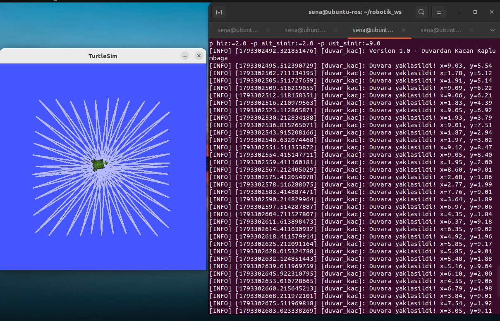
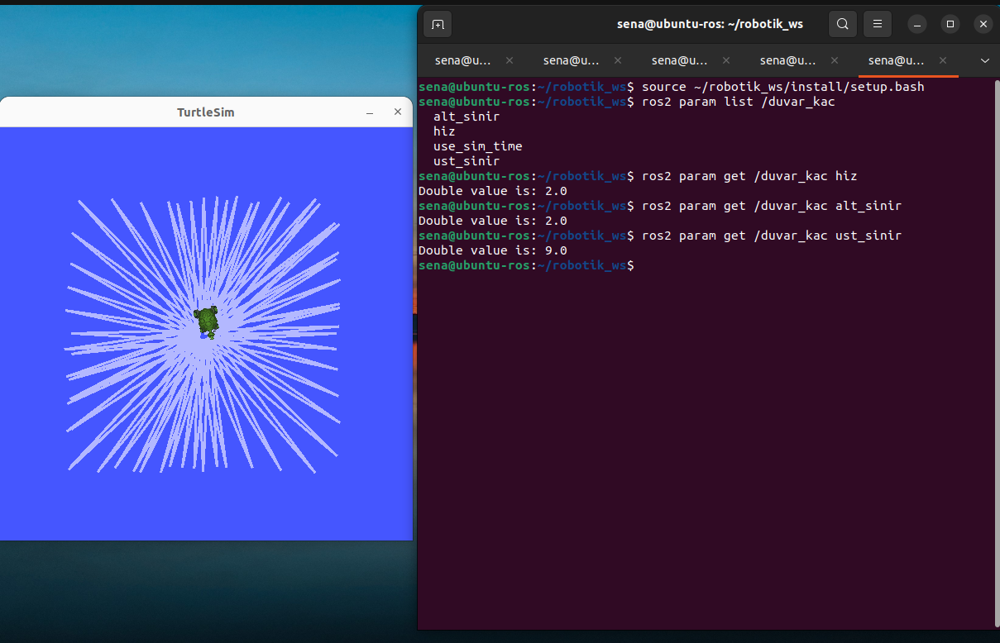

# 🐢 Duvardan Kaçan Kaplumbağa

ROS 2 Humble ve Python ile geliştirilmiş, Turtlesim ortamında duvarları algılayarak yön değiştiren otonom kaplumbağa uygulaması.

## Ödev Gereksinimleri

- `turtle_duvar_py` isimli Python paketi oluşturuldu.
- `/turtle1/pose` üzerinden kaplumbağanın X ve Y koordinatları okundu.
- `/turtle1/cmd_vel` üzerinden hareket komutları gönderildi.
- Kaplumbağanın otonom olarak ileri hareket etmesi sağlandı.
- X veya Y koordinatı `1.0` altına ya da `10.0` üzerine çıktığında yön değiştirmesi sağlandı.
- Duvar algılandığında `get_logger().info()` ile terminale uyarı yazdırıldı.

**Bonus:** Hareket hızı ve duvar sınırları ROS 2 parametreleriyle değiştirilebilir.

| Parametre | Açıklama |
|---|---|
| `hiz` | İleri hareket hızı |
| `alt_sinir` | Alt sınır |
| `ust_sinir` | Üst sınır |

## Kurulum

Ubuntu ve ROS 2 Humble kurulu bir ortamda:

```bash
mkdir -p ~/robotik_ws/src
cd ~/robotik_ws/src
git clone https://github.com/aysenaokksz/turtle_duvar_py.git

cd ~/robotik_ws
source /opt/ros/humble/setup.bash
colcon build --packages-select turtle_duvar_py --symlink-install
source install/setup.bash
```

## Çalıştırma

**Terminal 1 — Turtlesim:**

```bash
source /opt/ros/humble/setup.bash
ros2 run turtlesim turtlesim_node
```

**Terminal 2 — Kaplumbağa kontrolü:**

```bash
source /opt/ros/humble/setup.bash
source ~/robotik_ws/install/setup.bash
ros2 run turtle_duvar_py duvar_kac
```

**Bonus — Parametrelerle çalıştırma:**

```bash
ros2 run turtle_duvar_py duvar_kac --ros-args -p hiz:=2.0 -p alt_sinir:=2.0 -p ust_sinir:=9.0
```

## Ekran Görüntüleri

**1. Duvar algılama ve otonom hareket**



**2. ROS 2 parametrelerinin kontrolü**



## Proje Dosyaları

- `turtle_duvar_py/duvar_kac.py` — Hareket ve duvar algılama kodu
- `setup.py` — ROS 2 çalıştırılabilir dosya tanımı
- `package.xml` — Paket bağımlılıkları
- `images/` — Test ekran görüntüleri

**Not:** `build/`, `install/` ve `log/` klasörleri derleme çıktısı olduğu için depoya eklenmemiştir.
